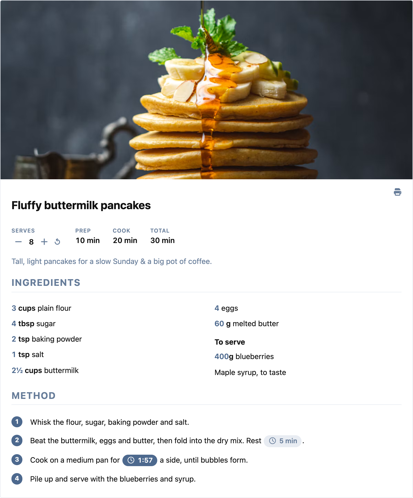
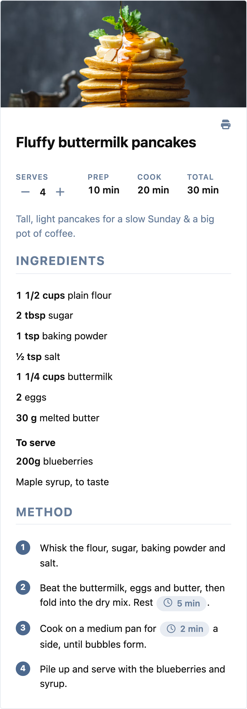
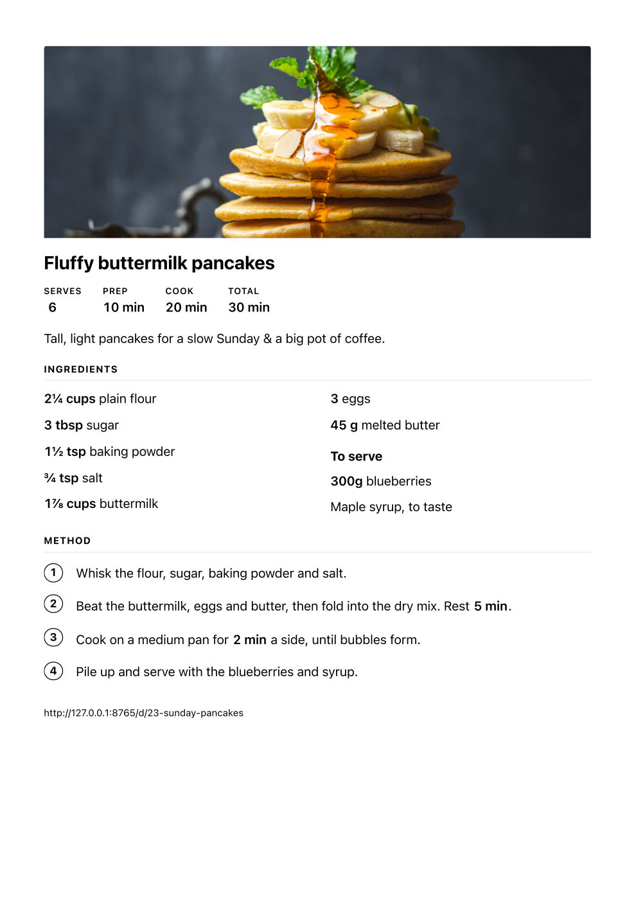
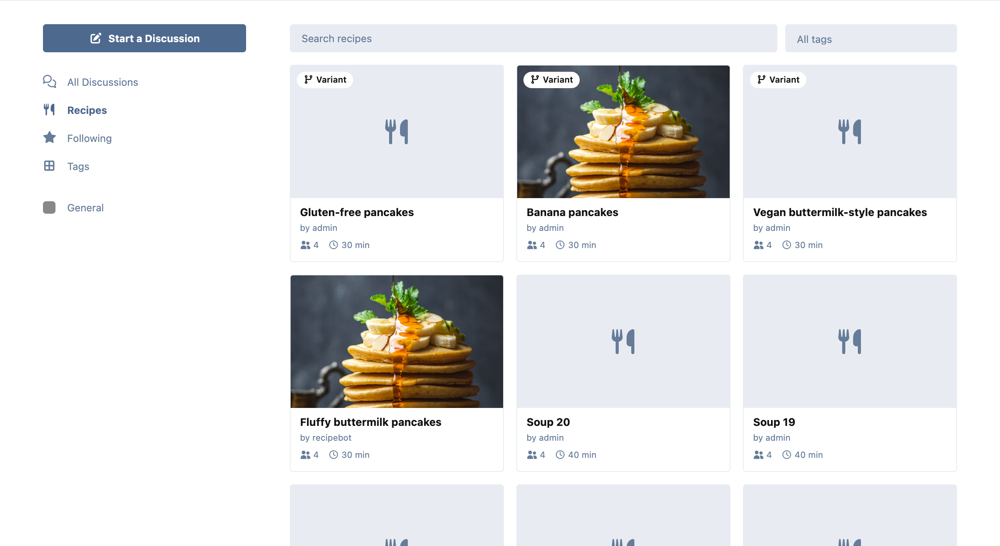
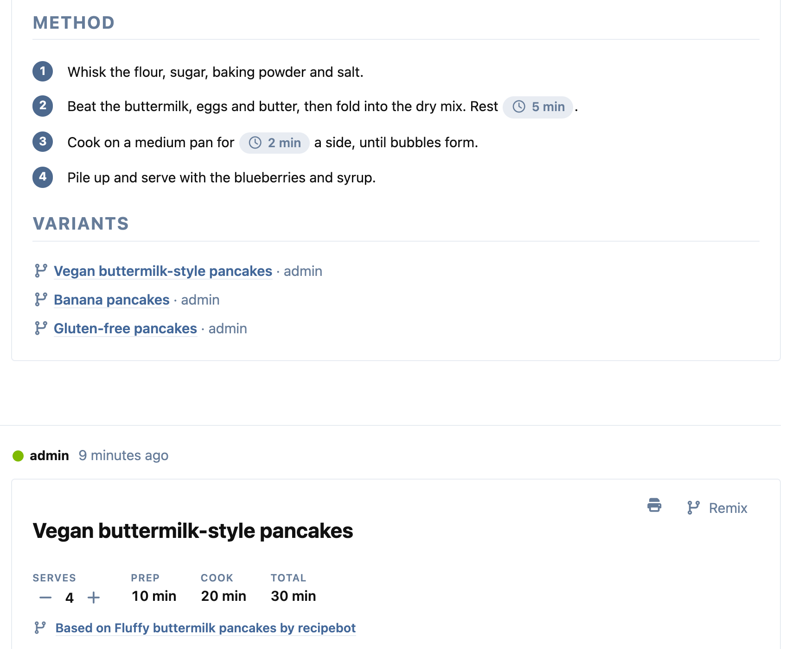
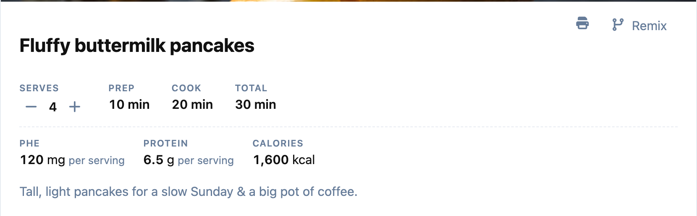
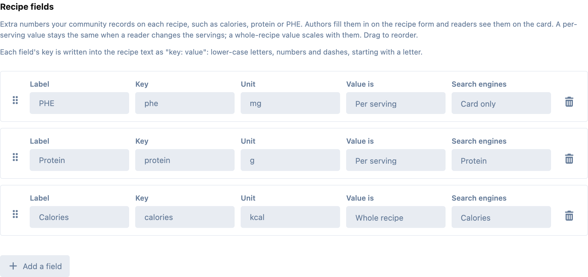
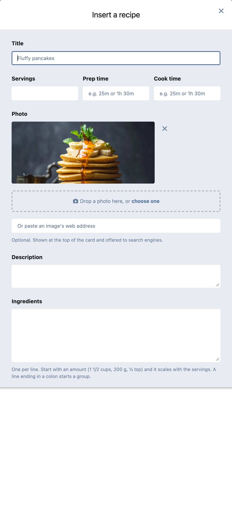
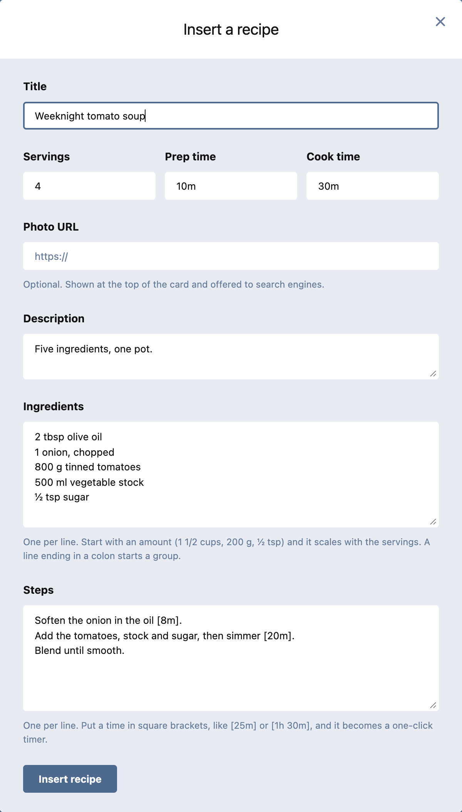
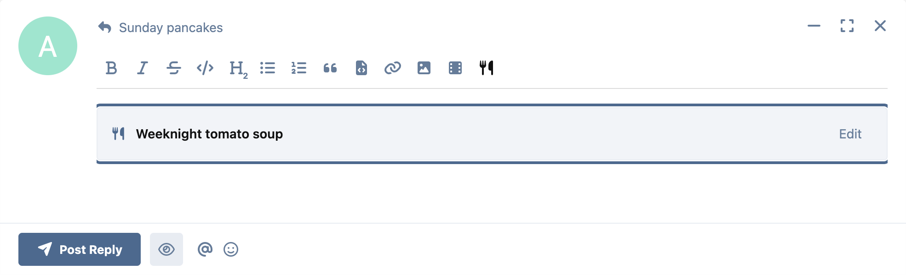

# Recipes for Flarum

**Structured recipes in posts.** A recipe card with ingredients that scale
when the reader changes the servings, steps with one-click timers, a clean print
view, and schema.org Recipe data so search engines can show it as a recipe.

Works with every editor a Flarum 2 forum can run: Flarum's own composer (plain,
Markdown or BBCode), [FoF Rich Text](https://github.com/FriendsOfFlarum/rich-text)
and [Scribe](https://github.com/ernestdefoe/scribe).

[](https://flarum.org)
[](LICENSE)


---

## What readers get

- **Servings that scale the ingredients.** Press + or − and every amount
  updates as a cook would write it: `1½ cups` doubles to `3 cups`, `⅓ cup`
  becomes `⅔`, metric amounts stay decimals in the reader's own format
  (`1,5 kg` on a German forum). Unit words follow the number, so `1 cup`
  doubled reads `2 cups`. A line with no amount (`salt, to taste`) is left alone.
- **Timers.** A step that says `Bake for [25m]` shows a 25 min button. One click
  starts it, the next pauses, and it beeps when it is done. It counts against
  the clock, so a background tab doesn't slow it down.
- **Ticks.** Every ingredient and step has a checkbox, so you can follow what
  is already in the bowl. Tap the line to tick it; ticked lines are struck
  through, and a ticked step's number becomes a check mark. Ticks are kept in
  the reader's own browser (guests too), stay on the same line when the
  servings change, survive a reload, and are forgotten after a day or as soon
  as the recipe is edited. **Clear ticks** unticks the lot. Printing leaves
  them out.
- **Print.** The print button prints just the recipe, at the servings the reader
  picked, with the page address underneath. Nothing else from the forum.
- **Everything without JavaScript, too.** The card is server-rendered HTML, so
  emails, feed readers and search engines see the whole recipe.




| On a phone | Printed |
|---|---|
|  |  |

## A recipe directory

**Recipes** in the sidebar opens a page listing every recipe on the forum as a
card: photo, title, author, servings and time, linked to the post it lives in.
Search it by name or filter it by tag. It lists only recipes the visitor is
allowed to see, and the server sends it as plain links too, for search engines
and readers without JavaScript.



## Variants

Every recipe card has a **Remix** button. It opens the recipe form with a copy
of the recipe to change, as a reply in the same discussion (the usual "I made it
vegan" case) or as a discussion of its own. The new card says which recipe it is
**based on**, with a link back, and the original lists its **variants**
underneath, so you can follow the branches either way. Search engines get the
link too, as schema.org `isBasedOn`.



## Your own fields: protein, PHE, calories…

Every community counts something different. In the admin panel you define the
numbers your recipes should carry, such as calories, protein, or the PHE someone
on a PKU diet has to track, each with a label and a unit, dragged into the order
you want.

For each field you choose whether its value is **per serving**, so it stays the
same when a reader changes the servings, or **for the whole recipe**, so it
scales with them. Values are shown exactly as entered, never rounded to a
"nice" number. Link a field to a schema.org nutrition property (calories,
protein, fat, carbohydrate, sugar, fibre, sodium…) and search engines get it,
per serving, as the recipe's nutrition information. A field with no schema.org
equivalent, like PHE, is shown on the card only.





## What authors get

A **Recipe** button in the composer opens a form: title, servings, prep and cook
times, an optional photo, a description, ingredients and steps (one per line).

- Amounts can be written however people write them: `2`, `1 1/2`, `1½`, `½`,
  `1.5`, `1,5`, `200g`, `2–3`.
- A line ending in a colon (`For the sauce:`) starts a group.
- `[25m]`, `[1h 30m]` or `[45s]` in a step becomes a timer.

In **Scribe** and **FoF Rich Text** the recipe is a block you can select, drag
and delete; double-click it, or press **Edit**, to change it. In the plain
composer, put the cursor inside a recipe and press the button to edit it.

The composer preview shows the card as you type.

### Photos

Drop a photo on the form, or choose one: JPEG, PNG or WebP up to 10 MB. The
forum re-encodes it as WebP (at most 1600 px), which strips everything but the
pixels, including a phone photo's location, and stores it under a random name
in `public/assets/recipes` (or wherever a storage driver puts the
`ernestdefoe-recipes` disk). Who may upload is the **Upload recipe photos**
permission, Members by default. Uploads are limited to 10 a minute and 100 a
day per member.

A photo that never makes it into a saved post is deleted after a day, by the
daily `recipes:prune-photos` task (and whenever its uploader uploads again). A
photo edited out of a recipe, or whose post is deleted, is deleted too, unless
a variant still shows it.

**Allow images from web addresses** (in the extension's settings, on by
default) keeps the old way of pasting an image's address. Turn it off and only
uploaded photos are accepted: the address box disappears and the server refuses
a recipe that links an image from another site when it is saved. Recipes posted
before keep their images, and an edit or a remix may keep an image already shown
on the forum; nothing is rewritten.



| The form | In Scribe |
|---|---|
|  |  |

### Writing one by hand

The form writes this, and you can too:

```
[recipe]
title: Fluffy pancakes
servings: 4
prep: 10m
cook: 20m
image: https://example.com/pancakes.jpg

A weekend breakfast.

[ingredients]
1 1/2 cups flour
2 tbsp sugar
For the topping:
200 g blueberries
[/ingredients]

[steps]
Whisk the dry ingredients.
Cook each side [2m] until golden.
[/steps]
[/recipe]
```

A variant adds `based-on: 123`, the post id of the original. Remix writes it
for you. Your own fields are lines like `protein: 6.5`, using each field's key.

Recipe text is plain text: Markdown and BBCode inside a recipe are shown as
written.

## Search engines

The first post's recipe is published as a schema.org `Recipe`: name, image,
description, author, date, yield, prep/cook/total times, ingredients and steps
(groups become `HowToSection`s). It is the only structured data Recipes adds, so
it sits alongside [FoF SEO](https://github.com/FriendsOfFlarum/seo) and
[Waymark](https://github.com/ernestdefoe/waymark) without repeating anything
they publish. A recipe in a reply is not the page's recipe and is left out. A
first post the visitor cannot see is never described.

## Installation

```bash
composer require ernestdefoe/recipes
php flarum cache:clear
```

Enable **Recipes** in the admin panel. If your community records numbers on its
recipes, define them on the extension's page.

Recipes keeps a small index of where recipes are, so the directory and variant
links never have to read every post. It is filled when the extension is enabled
and kept current as posts are written, edited and deleted. If you ever restore
posts from a backup or import them with a tool that bypasses Flarum, rebuild it:

```bash
php flarum recipes:reindex
```

With Scribe, the button joins the toolbar on its own unless you have arranged
the toolbar by hand. Then it waits in the toolbar builder for you to place it.

## Updating

```bash
composer update ernestdefoe/recipes
php flarum cache:clear
```

## Good to know

- A recipe written in Flarum's own composer opens as text if the forum later
  switches to Scribe, because Scribe edits HTML. Insert it again with the button.
- Unit singular/plural swapping knows English unit words; any other word is left
  exactly as written.

## Requirements

- Flarum 2.0
- PHP 8.3+

## Support

- **Support forum:** [Recipes on ernestdefoe.online](https://ernestdefoe.online/d/144)
- **Flarum community:** [Recipes on discuss.flarum.org](https://discuss.flarum.org/d/40100)
- **Bug reports:** [GitHub issues](https://github.com/ernestdefoe/recipes/issues)

## Licence

MIT.
